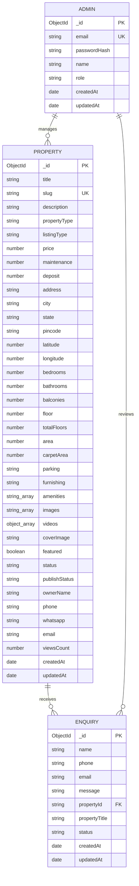

# Database Documentation - Purandhar Properties

This document outlines the data model, database connection lifecycle, Mongoose schemas, indexing strategies, regional metrics, and offline fallback mechanisms for the Purandhar Properties application.

---

## 1. Database Architecture & Dual Engine

The platform operates on a **resilient dual data engine**:

1. **Primary Production Engine (MongoDB + Mongoose):**
   - Connects to MongoDB Atlas or local MongoDB using the connection string in `MONGODB_URI`.
   - Utilizes connection pooling and cached connections (`global.mongoose`) in `lib/database/db.ts` to prevent duplicate connections during Next.js Hot Module Replacement (HMR).
2. **Offline Fallback Engine (In-Memory Store):**
   - Implemented in `lib/utilities/store.ts`.
   - Automatically activates if `MONGODB_URI` is omitted or if the database is unreachable.
   - Initialized with sample data from `lib/database/seedData.ts`.
   - Guarantees zero downtime, offline evaluation for college viva/examinations, and instant local demoing.

---

## 2. Entity-Relationship (ER) Diagram



---

## 3. Schema Definitions

### 3.1. Property Collection (`models/Property.ts`)

Represents real estate listings, land plots, agricultural parcels, and rental properties in the Purandar / Pune region.

| Field Name | Type | Constraints / Default | Description |
|---|---|---|---|
| `title` | `String` | Required, Trimmed | Headline of the listing (e.g. *"2 Guntha NA Plot near Saswad"*) |
| `slug` | `String` | Required, Unique, Indexed | SEO URL identifier generated from title + random salt |
| `description` | `String` | Required | Full narrative description with land specifications |
| `propertyType` | `String` | Required, Indexed | Category: `Agricultural Land`, `NA Plot`, `Villa`, `Apartment`, `Commercial`, `Farmhouse` |
| `listingType` | `String` | Required, Enum: `['Sale', 'Rent']`, Indexed | Transaction nature |
| `price` | `Number` | Default: `0`, Indexed | Price in INR (₹) |
| `maintenance` | `Number` | Default: `0` | Monthly maintenance charges |
| `deposit` | `Number` | Default: `0` | Security deposit (for rentals) |
| `address` | `String` | Required | Street or survey number |
| `city` | `String` | Required, Indexed | City / Town (e.g., `Saswad`, `Jejuri`, `Narayanpur`, `Bhor`, `Hadapsar`, `Shirwal`) |
| `state` | `String` | Required | Default: `Maharashtra` |
| `pincode` | `String` | Required | 6-digit PIN code |
| `latitude` | `Number` | Optional | Geo coordinates for Google Maps integration |
| `longitude` | `Number` | Optional | Geo coordinates for Google Maps integration |
| `bedrooms` | `Number` | Default: `0` | 0 for plots / agricultural land |
| `bathrooms` | `Number` | Default: `0` | Bathroom count |
| `balconies` | `Number` | Default: `0` | Balcony count |
| `floor` | `Number` | Optional | Floor level |
| `totalFloors` | `Number` | Optional | Total floors in building |
| `area` | `Number` | Default: `0`, Indexed | Built-up or land area in **Square Feet** |
| `carpetArea` | `Number` | Optional | Usable carpet area |
| `parking` | `String` | Default: `'None'` | Parking availability (`Open`, `Covered`, `None`) |
| `furnishing` | `String` | Default: `'Unfurnished'` | `Furnished`, `Semi-Furnished`, `Unfurnished` |
| `amenities` | `[String]` | Array of strings | Tags: `Water Connection`, `Tar Road Touch`, `Fencing`, `Electricity`, etc. |
| `images` | `[String]` | Array of URLs | Cloudinary or local image paths |
| `videos` | `[{ url, title, thumbnail }]` | Array of objects | Embedded video tour references (YouTube/Vimeo/Cloudinary) |
| `coverImage` | `String` | Default: `''` | Main thumbnail image URL |
| `featured` | `Boolean` | Default: `false`, Indexed | Flag for homepage spotlight carousel |
| `status` | `String` | Default: `'Available'`, Enum: `['Available', 'Sold', 'Rented']`, Indexed | Current sale status |
| `publishStatus` | `String` | Default: `'Published'`, Enum: `['Draft', 'Published']`, Indexed | Visibility status |
| `ownerName` | `String` | Required | Seller or broker contact person |
| `phone` | `String` | Required | Calling telephone number |
| `whatsapp` | `String` | Required | Direct WhatsApp contact number |
| `email` | `String` | Required | Contact email address |
| `viewsCount` | `Number` | Default: `0` | Auto-incremented view counter |
| `timestamps` | `Date` | Mongoose `{ timestamps: true }` | Generates `createdAt` and `updatedAt` |

---

### 3.2. Enquiry Collection (`models/Enquiry.ts`)

Captures buyer inquiries, property visit requests, and consultations submitted through public forms.

| Field Name | Type | Constraints / Default | Description |
|---|---|---|---|
| `name` | `String` | Required | Lead's full name |
| `phone` | `String` | Required | Primary phone / WhatsApp number |
| `email` | `String` | Required | Contact email |
| `message` | `String` | Required | User inquiry or question |
| `propertyId` | `String` | Optional | Referenced property ID |
| `propertyTitle` | `String` | Optional | Referenced property title snapshot |
| `status` | `String` | Enum: `['New', 'Contacted', 'Closed']`, Default: `'New'`, Indexed | Lead workflow status |
| `timestamps` | `Date` | Mongoose `{ timestamps: true }` | Generates `createdAt` and `updatedAt` |

---

### 3.3. Admin Collection (`models/Admin.ts`)

Stores authenticated administrative credentials for managing listings and leads.

| Field Name | Type | Constraints / Default | Description |
|---|---|---|---|
| `email` | `String` | Required, Unique, Lowercase, Trimmed | Administrator login email |
| `passwordHash` | `String` | Required | Salted hash generated via `bcryptjs` (Cost factor: 10) |
| `name` | `String` | Required, Default: `'Administrator'` | Display name |
| `role` | `String` | Default: `'admin'` | Role-based authorization |
| `timestamps` | `Date` | Mongoose `{ timestamps: true }` | Generates `createdAt` and `updatedAt` |

---

## 4. Regional Land Metrics & Conversions (Purandar Region)

The application handles standard Indian land measurement units predominantly used in Maharashtra land records (7/12 extract / Satbara Utara):

$$1\text{ Guntha} = 1,089\text{ sq ft} = 101.17\text{ sq meters}$$
$$40\text{ Guntha} = 1\text{ Acre} = 43,560\text{ sq ft} = 4,046.86\text{ sq meters}$$

- **Storage Convention:** All property areas are normalized and stored internally in `area` as **Square Feet (`sq ft`)**.
- **Display Conversion:**
  - When users view farm plots or NA lands, the interface formats the area as Guntha or Acre:
    $$\text{Guntha} = \frac{\text{Area in sq ft}}{1,089}$$
    $$\text{Acre} = \frac{\text{Area in sq ft}}{43,560}$$

---

## 5. Database Indexing Strategy

To guarantee **< 10ms query latency** under heavy multi-criteria filtering:

1. **Single-Field Indexes:**
   - `slug`: Fast route resolution `/property/[slug]` (`unique: true`).
   - `city`: High-traffic regional lookup.
   - `propertyType`: Fast category filtering.
   - `price` & `area`: Fast range slider queries (`$gte`, `$lte`).
   - `publishStatus` & `featured`: Quick public dashboard queries.
2. **Sorting Optimization:**
   - Indexing on `createdAt` and `price` eliminates expensive in-memory sort operations on large property datasets.

---

## 6. Database Connection Lifecycle (`lib/database/db.ts`)

```typescript
// Connection caching pattern
let cached = global.mongoose;

if (!cached) {
  cached = global.mongoose = { conn: null, promise: null };
}

export async function connectDB() {
  if (!process.env.MONGODB_URI) {
    return null; // Triggers instant in-memory fallback
  }
  if (cached.conn) {
    return cached.conn;
  }
  if (!cached.promise) {
    cached.promise = mongoose.connect(process.env.MONGODB_URI, {
      bufferCommands: false,
    }).then((m) => m);
  }
  cached.conn = await cached.promise;
  return cached.conn;
}
```

---

## 7. Sample Seeding & Resetting

To initialize the database with authentic Purandar properties (Saswad, Jejuri, Narayanpur plots):

- **Via Web Interface:** Visit `/admin` and click **Seed Database**, or send a POST request:
  ```bash
  curl -X POST http://localhost:3000/api/seed
  ```
- **Seeded Records:**
  - 6+ pre-configured properties with photos, coordinates, and prices.
  - 3 initial customer inquiries.
  - 1 Administrator account (`admin@realestate.com` / `admin123`).
