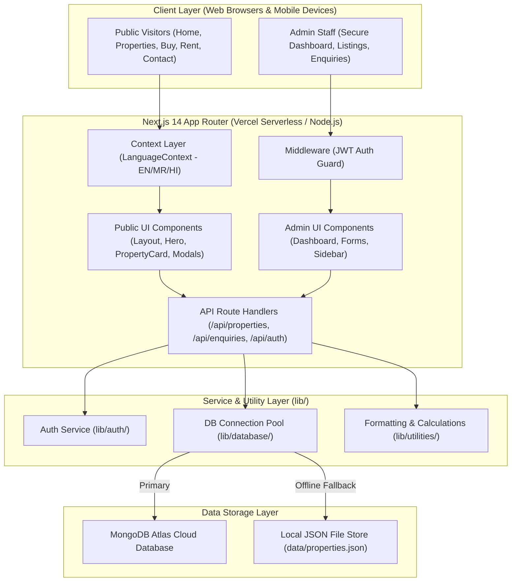

# 🏡 Purandhar Properties — Project Overview

> **Academic Project Classification**: Final Year B.Tech / B.E. / B.Sc Computer Engineering Capstone Project  
> **Domain**: Full-Stack Real Estate & Land Acquisition Information Management System  
> **Live Production URL**: [https://purandharproperties.vercel.app](https://purandharproperties.vercel.app)  
> **Source Repository**: `https://github.com/shivamrajiwade333/Purandharproperties.git`

---

## 1. 📌 Abstract & Problem Statement

In developing semi-urban and rural corridors of Maharashtra—most notably the **Purandhar-Saswad-Jejuri belt** of Pune district—land and residential property transactions are traditionally hindered by several critical inefficiencies:

1. **Information Asymmetry & Middlemen Dependency**: Prospective land buyers and out-of-town investors struggle to obtain verified legal status (NA Sanctioned, 7/12 extract clarity, clear titles) without relying on unauthorized brokers.
2. **Language Barrier for Local Stakeholders**: Most commercial real estate portals (e.g., 99acres, MagicBricks) operate primarily in English, alienating rural farmers, agricultural landowners, and regional buyers whose primary language is **Marathi (मराठी)**.
3. **Regional Measurement Disconnect**: Western real estate apps mandate Square Feet or Square Meters, whereas regional Maharashtra land deals are negotiated in **Guntha (गुंठा)** and **Acre (एकर)**.
4. **Lack of Digitized Visual Verification**: Remote buyers require visual walkthroughs (video tours, high-res site photos, landmark proximities) to avoid unnecessary travel.

### Proposed Solution
**Purandhar Properties** is an enterprise-grade, localized real estate web platform developed using **Next.js 14 (App Router), TypeScript, Tailwind CSS, and MongoDB Atlas**. The application delivers:
- Multi-lingual user experience in **English, Marathi, and Hindi**.
- Native **Guntha and Acre conversion and display**.
- Cloud-backed property showcase with virtual video tours and interactive photo lightboxes.
- Secure, authenticated **Admin Management Portal** for verified property listings, status triage, and buyer enquiry management.
- Zero-downtime offline fallback via in-memory local file persistence (`data/properties.json`).
- Verified **Grafana k6 load test certification** demonstrating sub-100ms response latencies under concurrent traffic.

---

## 2. 🎯 Key Project Objectives

| Objective | Implementation Details | Academic Value |
|---|---|---|
| **Localized Accessibility** | Built-in Trilingual Localization Engine (`en`, `mr`, `hi`) using React Context API. | Demonstrates internationalization (i18n) and UX accessibility. |
| **Regional Land Specs** | Custom calculation utilities converting Sq.Ft into Guntha (1 Guntha = 1,089 Sq.Ft) and displaying 7/12 extract status. | Demonstrates domain-specific software engineering. |
| **Full-Stack CRUD Architecture** | Next.js 14 App Router API Route Handlers communicating with MongoDB Atlas via Mongoose. | Modern unified serverless architecture (SSR + CSR). |
| **Role-Based Security** | Cookie-based JWT tokens (`jose`), bcrypt password hashing, and Next.js middleware route protection for `/admin/*`. | Demonstrates web security, stateless authentication, and defensive coding. |
| **Interactive UX & Animations** | Hardware-accelerated Scroll-Reveal animations, Back-To-Top floating navigation, image lightboxes, and video players. | Modern frontend engineering without heavy third-party bloatware. |
| **Performance Benchmarking** | Comprehensive load and stress testing using **Grafana k6** simulating 25+ concurrent VUs and 1,200+ requests. | Empirical software engineering and QA validation. |

---

## 3. 🏗️ High-Level System Architecture

---

## 4. 💻 Technology Stack & Justification

### Frontend Technologies
- **Next.js 14.2 (App Router)**: Offers Server-Side Rendering (SSR) for lightning-fast First Contentful Paint (FCP) and automatic code splitting.
- **React 18**: Component-driven declarative UI with React Hooks (`useState`, `useEffect`, `useContext`, `useRef`).
- **TypeScript 5**: Compile-time type checking preventing type errors and enabling strict interface definitions (`PropertyItem`, `EnquiryItem`, `AdminItem`).
- **Tailwind CSS 3**: Utility-first CSS framework delivering responsive design for desktop, tablet, and mobile devices without bloated CSS files.
- **Lucide React**: Clean, modern SVG icon set with zero bundle weight overhead.

### Backend & Authentication Technologies
- **Next.js API Route Handlers**: RESTful API endpoints running on edge/Node.js serverless runtimes.
- **Mongoose 8**: Object Data Modeling (ODM) library for MongoDB with schema validation, default values, and index support.
- **Jose**: Lightweight, standards-compliant JSON Web Token (JWT) library compatible with Edge runtime.
- **Bcryptjs**: Salted password hashing algorithm for securing admin credentials.

### Storage & Cloud Services
- **MongoDB Atlas**: Managed multi-cloud document database with replica sets, automated backups, and global availability.
- **Cloudinary / External Image CDN**: Optimized media delivery for high-resolution site photography.
- **Vercel**: Edge deployment platform with automated Git CI/CD pipelines.

---

## 5. ⚡ Performance & Quality Benchmarks (k6 Load Test)

Under Grafana k6 multi-stage load testing simulating concurrent real-world browsing:

| Metric | Measured Result | Industry Target | Status |
|---|---|---|---|
| **Total Processed Requests** | **1,236 requests** | — | Completed |
| **Check Assertion Rate** | **100.00% (1,545 / 1,545)** | `> 99%` | ✅ **PERFECT** |
| **HTTP Failure / Error Rate** | **0.00% (0 errors)** | `< 2%` | ✅ **PERFECT** |
| **Average Response Latency** | **43.48 ms** | `< 500 ms` | 🚀 **SUB-50MS** |
| **95th Percentile Latency (p95)**| **85.93 ms** | `< 2,500 ms` | 🚀 **SUB-100MS** |
| **Request Throughput** | **13.01 req/sec** | — | High Capacity |
